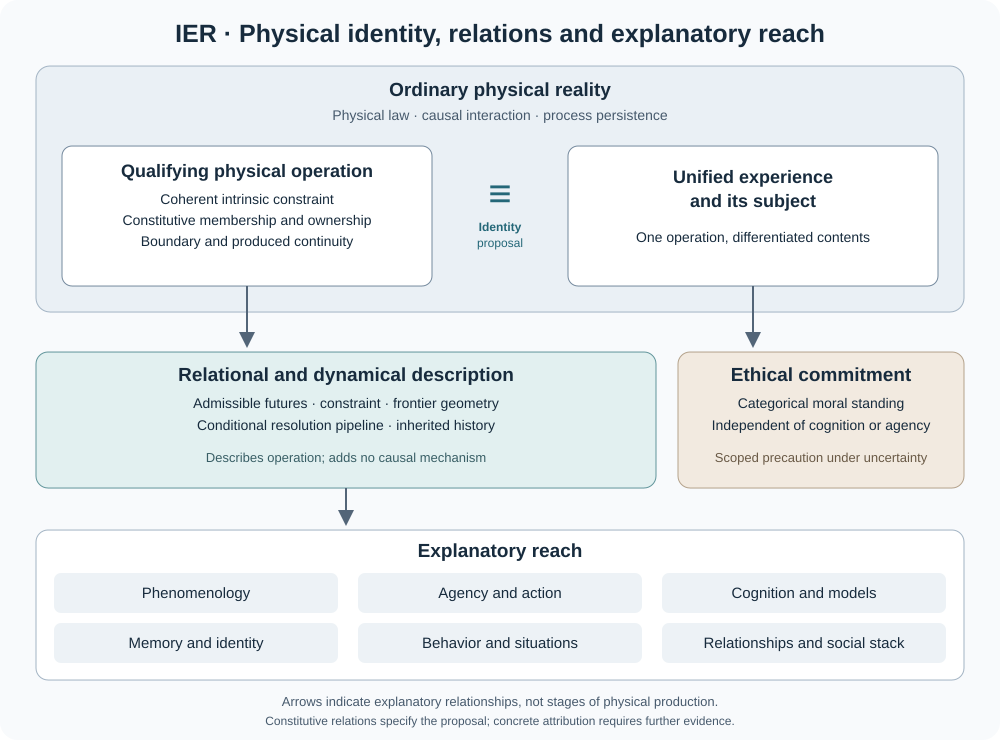

---
ier:
  tier: T4
  role: ORIENTATION
  provides: []
  status: canonical
  layer: framework
  domain:
  - guardrails_and_orientation
  category: reader_orientation
  filename: IER-tldr.md
  version: 10.12.3
  requires:
    hard:
    - IER-specification
    structural:
    - IER-processes
    - IER-continuity
    - IER-dynamics
    - IER-ethics
    - IER-strawson
    guardrails:
    - IER-non-goals
    - IER-diagnostics
---

# IER TL;DR

## Physical Identity and the Relational Framework

**Informational Experiential Realism (IER v10.12.3)**\
*T4 · Orientation · Non-Normative · Canon-Constrained*

## Status, Scope, and Authority

This orientation introduces no new theoretical commitments. The
[Specification](IER-specification.md) and canonical definition owners retain
authority.

## In Technical Terms

* Physicalist monism and process ontology: one mind-independent physical reality;
  subjects are continuing physical operations.
* A posteriori physical identity: experience, subject, and one qualifying Unified
  Experiential Field (UEF) operation are numerically identical. The proposal is
  abductive and a posteriori, rather than a deduction from physical description.
* Non-aggregative experiential unity: one globally integrated operation bears
  and resolves intrinsic constraint; experiences of parts are not summed.
* Relational individuation: constitutive participation fixes subject scope;
  anatomical enclosure and causal influence alone do not establish membership.
* Diachronic process identity: persistence requires produced, inherited,
  operation-mediated, uniquely one-to-one continuation through material turnover.
* Constraint-based dynamics: admissible futures and inherited physical history
  organize continuation; irreversible foreclosure is conditional, not continuous.
* Categorical subjecthood and moral standing: cognition and intelligence are
  neither necessary nor sufficient for experience; standing does not scale with
  cognitive sophistication under IER's ethical commitments.

Concrete subject attribution remains an empirical question. See the expanded
[IER Theory Card](IER-quick-start.md#ier-theory-card).

## In Everyday Language

IER proposes that experience is real and fully physical. It asks what kind of
physical activity could itself be an experience and the subject having it, and
how that activity continues, changes, and relates to the world.

1. What a subject is. A subject is a particular kind of continuing physical
   activity. Like a waterfall, it can persist while its material changes. What
   belongs to it depends on how processes take part in that activity, rather than
   simply where they sit inside a brain or body.
2. How it works. Everything follows ordinary physical causation. Information
   describes physical differences that affect what can happen next. There is no
   extra force or inner controller.
3. What experience is. IER proposes that the unified activity itself is both
   the experience and the subject having it. A brain does not produce an
   experience for a separate observer inside it, or assemble little experiences
   into a larger one.
4. How it changes. Present organization shapes what can happen next, and past
   events continue to matter through their physical effects. Some changes
   irreversibly close off possibilities; simply continuing need not do so.
5. What it helps explain. Feeling, thinking, remembering, acting, and relating
   to others offer different ways to examine experiential life. Each application
   must show what IER helps explain; using its vocabulary is not enough.
6. Why it matters ethically. Under IER’s ethical commitments, a being's
   experience gives it moral standing regardless of how intelligent or capable
   it is. Uncertainty about which beings have experience calls for care suited
   to the case.

## Non-Goals and Assessment

IER specifies constitutive relations; identifying their occurrence in a concrete
system is a further empirical question. It does not promise an external
consciousness detector, a mechanism producing an additional experience, or a
derivation of what makes red red. A detailed physical-to-qualitative mapping is
not a prerequisite for its account of subjecthood, unity, and persistence.

The identity proposal is abductive and a posteriori. Its arguments remain open
to criticism, and its applications must earn their interpretations. The diagram
shows explanatory relationships, not stages in which physical activity produces
experience. [Non-Goals](IER-non-goals.md) explains the scope boundary.
